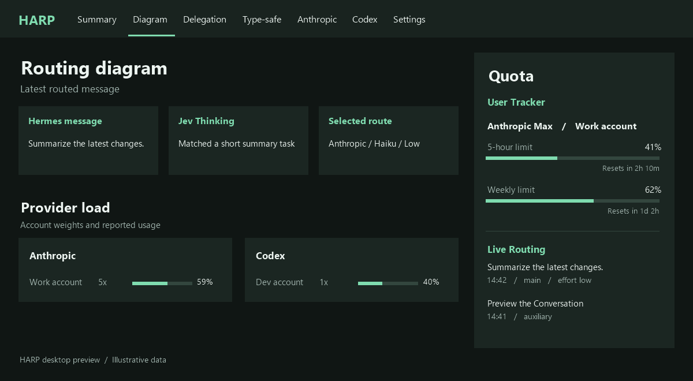
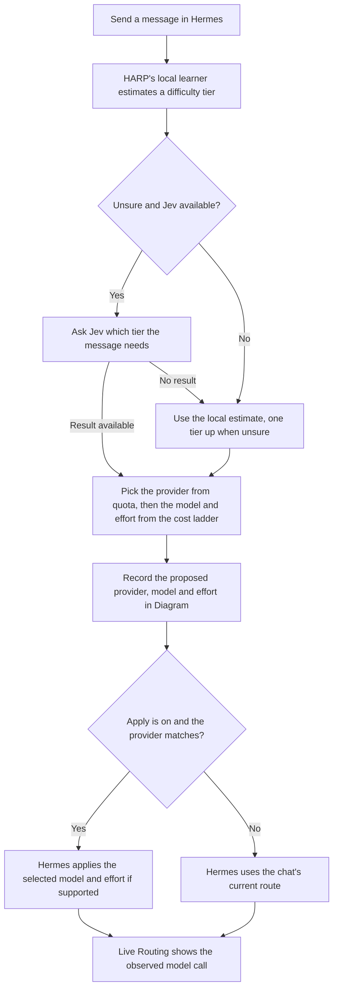

# Hermes Adaptive Router Plugin (HARP)

HARP adds model routing, account quota monitoring, and subagent route settings to Hermes Agent and Hermes Desktop. It works with Hermes credential pools for Anthropic and OpenAI Codex and can use Jev by TypeSafe to classify requests.

[](LICENSE)
[](https://github.com/Antony-12s/hermes-adaptive-router-plugin)
[](https://github.com/Antony-12s/hermes-adaptive-router-plugin/actions/workflows/tests.yml)



*Illustrative preview with sample account and quota data.*

## Features

| Feature | What you can do |
| --- | --- |
| Summary | Review usage, recent token totals, account health, and a weekly or monthly activity heatmap. |
| Diagram | Inspect the latest routing decision and the cost ladder, and give the local learner feedback. With the ladder off, edit candidate models and effort limits instead. |
| Account pools | Check 5-hour and weekly quota windows and reset times per account when the provider reports them. Set weights of 1×, 5×, 10×, or 20×. |
| Heavyweight routing | Prefer one provider for demanding work, or let the provider with more weighted quota left run it. |
| Delegation | Save work types with a provider, model, and effort for Hermes subagents. Choose Local matching or Jev. |
| Quota pane | Open provider accordions, see the current chat’s quota context, and inspect recent main and auxiliary model calls in Live Routing. |
| Schedules and alerts | Schedule account parking and receive quota notifications through your desktop or Hermes Telegram channel. |

## Requirements

| Component | When you need it |
| --- | --- |
| [Hermes Agent](https://hermes-agent.nousresearch.com/) | Required. Use a Hermes release with [LLM request middleware](https://hermes-agent.nousresearch.com/docs/developer-guide/middleware) for Apply mode. Hermes Delegation also requires a release with delegation-provider support. |
| [Hermes Desktop](https://hermes-agent.nousresearch.com/docs/user-guide/desktop) | Required for the HARP desktop tabs, chat quota controls, and right-hand Quota pane. The Agent backend and browser admin dashboard can run without Desktop. |
| Anthropic or OpenAI Codex | Sign in to the provider you want HARP to route or monitor. One configured provider is enough to get started. Comparing quota or switching between those providers requires both. |
| Jev by TypeSafe | Optional. Add a Jev API key to enable Jev classification. The local learner works without one. |
| Operating system | The same HARP package supports Windows, Linux, and macOS. See [Platform support](#platform-support) for timer and notification requirements. |

## Install

1. Install Hermes Agent and sign in to the provider you want to use. Install Hermes Desktop if you want the desktop controls.
2. Run these commands from PowerShell on Windows or a terminal on Linux or macOS.

   ```text
   hermes plugins install https://github.com/Antony-12s/hermes-adaptive-router-plugin.git
   hermes plugins enable harp
   ```

3. Restart the Hermes gateway or reopen Hermes Desktop. In **Capabilities → Plugins**, rescan plugins and enable the HARP Desktop component. Open **HARP** from the sidebar.
4. If you use the browser admin dashboard, open **HARP Usage** to see the plugin’s dashboard view.

Use the same Hermes profile for installation, provider authentication, and the gateway. This repository ships one plugin for Windows, Linux, and macOS.

## How routing works



### The cost ladder

HARP rates each message from tier 0 (trivial) to tier 6 (maximum) and maps the tier to the cheapest model and
effort that should handle it. Cheap models think harder before work moves to a pricier model: tier 1 is Haiku 5.5
at high effort, tier 3 is Opus 5.5 at medium, tier 4 is Opus 5.5 at xhigh. From tier 2 up, the provider with more
weighted quota left runs the job. **Heavyweight** can prefer one provider from tier 3 up. **Focus** sets the highest
tier: Save stops at tier 2, Balanced at tier 4, and Best can use every tier. Effort runs low, medium, high, xhigh,
and max. See [training/README.md](training/README.md) for the full table, prices, and sources.

Turn **Cost ladder** off in **Diagram** to route among your own candidate models instead.

**Diagram** shows what HARP proposed. **Live Routing** shows the model Hermes actually called. In Shadow mode, HARP records its recommendation and Hermes continues with the chat's current route. A cross-provider quota switch is handled separately for a later message.

## Set up HARP

1. In **Anthropic** or **Codex**, use **Add account** if needed and **Live usage** to refresh quota readings. If Hermes omits an Anthropic plan, you can select a display plan for that account in **Quota → User Tracker**. Set routing weights separately in **Diagram → Provider load**.
2. In **Diagram**, review the cost ladder and choose a **Focus**. Leave **Heavyweight** on **Auto by quota** or prefer one provider. Save your changes. The ladder uses models your Hermes install lists for Anthropic and Codex; turn the ladder off to pick your own models.
3. Start in **Shadow** mode and send a normal Hermes chat message. Compare the recorded recommendation in **Diagram** with the request observed in **Quota → Live Routing**. Enable **Apply** when you are ready for HARP to change the model and effort within the chat’s current provider.
4. In **Settings**, choose a progress bar or a ring for quota display and set the current chat’s auto-switch preference. For a quota warning, **Switch now** applies the offered route to the next message, and **Ignore** dismisses the warning. Hermes may require confirmation for a provider change.

### Routing self-improvement

The repository includes an [optional routing dataset and offline training command](training/README.md)
for coding and general requests in Thai and English. HARP leaves this dataset
unused during normal operation.

HARP's local learner improves from Jev classifications and your feedback on real
Hermes requests. In **Diagram → What it learned**, select **Verify result** after
checking that the proposed model actually handled the task and passed your checks.
A verified run becomes a stronger training example than an unreviewed Jev pick.
Use **Right** or **Wrong** to rate or correct the route directly. HARP can send
reviewed examples to Jev to guide later classifications.

For recognized short weather lookups, HARP can reuse the verified provider,
model, and effort across equivalent Thai or English phrasings. Before any
result has been verified, HARP recommends the ladder's tier 0: Anthropic Claude
Haiku 5.5 at low effort. With the ladder off, it uses that model only if it is
configured in **Diagram → Models it can pick**. Provider quota still applies.

A successful API response alone does not verify that the task succeeded. HARP
learns which routes to recommend from these examples. It leaves model weights
to the provider.

### Jev and delegation

The local learner works without a Jev key. To use Jev, add a TypeSafe API key under **HARP → Type-safe** and check its status. Jev can receive request text and route criteria when asked to classify a message. HARP tracks its daily calls. Direct Jev calls do not currently populate the 24-hour token total.

In **HARP → Delegation**, add work types with a name, description, provider, model, and effort, then select **Save delegation**. On Hermes versions with delegation-provider support, add the following to your Hermes profile configuration and start a new session.

```yaml
delegation:
  backend: harp
```

Hermes runs the subagent using the saved route when a work type matches. An unmatched task uses the Hermes default. With Jev selected, HARP sends the task goal and work descriptions to TypeSafe and falls back to Local if Jev is unavailable.

### Optional gateway configuration

The main HARP router can run without a JSON configuration file. Use [harp.example.json](harp.example.json) if you also want the separate same-provider fast-model policy for short, text-only Chat Completions requests or the optional tagged token budgets.

Set the provider, primary model, and fast model to values supported by your Hermes profile. Set the absolute config path in the environment of the Hermes gateway before restarting it.

| System | Set the config path from your HARP checkout |
| --- | --- |
| Windows PowerShell | `Copy-Item .\harp.example.json .\harp.json`, then `$env:HARP_CONFIG = (Resolve-Path .\harp.json).Path` |
| Linux or macOS | `cp harp.example.json harp.json`, then `export HARP_CONFIG="$(pwd)/harp.json"` |

Use `daily_token_quotas` for observational budgets per account label, and set `HARP_USAGE_TAG` in the gateway environment to group activity. Set `HARP_ACCOUNT` only when the gateway is pinned to one account. Leave it unset when Hermes rotates credentials. The local aggregates reset at midnight UTC.

## Platform support

| System | Optional background timer |
| --- | --- |
| Windows | Task Scheduler |
| Linux | systemd user timer |
| macOS | LaunchAgent in the signed-in user session |

On Linux and macOS, `hermes` must be on PATH when registering the timer. Linux desktop alerts need `notify-send` and a notification service. Telegram alerts use Hermes on all three platforms.

## Local data

Live Routing displays the latest six observed calls and stores up to 100 events locally. For a main call that can be matched to its request, HARP stores a short excerpt of the user message. Quota readings and token totals reflect the data available to Hermes and HARP.

## Development

From a local checkout, run the checks below. GitHub Actions runs the Python and Desktop test suites on Windows, Linux, and macOS.

```text
hermes plugins doctor . --ci
python -B -m unittest discover -s tests
node --test tests/desktop.test.mjs
```

## License

HARP is available under the [MIT License](LICENSE).
